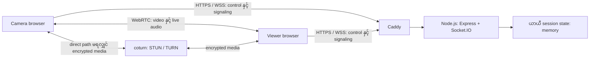

# RW MVP — Architecture

ဤစာတမ်းသည် [requirements.md](requirements.md) ရှိ F01–F12 နှင့် သဘောတူထားသော architecture ကို မှတ်တမ်းတင်ထားသည်။ MVP တွင် monitoring session တစ်ခုလျှင် camera browser ၁ ခုနှင့် တစ်ချိန်တည်း active viewer browser ၁ ခုသာရှိမည်။ Application code မပါ။

## စနစ်ပုံစံ

Node backend သည် pair လုပ်ခွင့်၊ viewer တစ်ဦးတည်းကန့်သတ်ချက်၊ status၊ WebRTC ချိတ်ဆက်ရန် message များနှင့် alarm command ကို စီမံသည်။ Video/audio payload ကို Node backend မှ မယူ၊ မသိမ်း။ Browser နှစ်ခုသည် တိုက်ရိုက် WebRTC ချိတ်မည်။ တိုက်ရိုက်ချိတ်မရလျှင် coturn မှ relay လုပ်မည်။

## Language နှင့် libraries

| အပိုင်း | ရွေးချယ်မှု | အလုပ်နှင့် ရွေးရသည့်အကြောင်း |
| --- | --- | --- |
| Frontend language | TypeScript 6 | Camera/viewer status၊ signaling message နှင့် permission state များ၏ data ပုံစံကို စစ်နိုင်ရန်။ |
| Frontend UI | React 19.3 | Setup, pairing, live, interrupted, ended စသည့် screen state များကို စီမံရန်။ |
| Frontend build | Vite 8 နှင့် `@vitejs/plugin-react` | Browser app ကို development နှင့် production build လုပ်ရန်။ Server-side rendering မလို။ |
| QR | `qrcode` | ခန့်မှန်းရန်ခက်သော invite link ကို camera screen ပေါ် QR အဖြစ်ပြရန်။ QR ထဲ PIN မပါ။ |
| Backend runtime | Node.js 24 LTS | Frontend နှင့် backend တွင် TypeScript/JavaScript ecosystem တစ်ခုတည်း သုံးနိုင်ရန်။ |
| HTTP API | Express 5 | Session စခြင်း၊ invite အသစ်ထုတ်ခြင်း၊ PIN ဖြင့် pair လုပ်ခြင်း၊ viewer session ပြန်စစ်ခြင်း၊ Stop လုပ်ခြင်းတို့အတွက်။ |
| Real-time control | Socket.IO 4.x client + server | Signaling၊ connection status၊ viewer count၊ alarm command/ack ကို ချက်ချင်းပို့ရန်။ |
| Input validation | Zod 4 | PIN၊ session ID နှင့် signaling message များကို server က လက်မခံမီ data ပုံစံ/အရွယ်အစား စစ်ရန်။ |
| Media | Browser `getUserMedia()` နှင့် `RTCPeerConnection` | Camera video၊ opt-in room audio၊ viewer Hold to Talk audio ကို live ပို့ရန်။ |
| STUN/TURN | coturn | မတူသော network များကြား direct path ရှာခြင်းနှင့် လိုအပ်ပါက media relay လုပ်ခြင်း။ |
| HTTPS entry | Caddy | Public HTTPS certificate နှင့် WebSocket reverse proxy အတွက်။ |

ရွေးချယ်ထားသော library များ၏ **official documentation** အရ ၂၀၂၆-၁၁-၁၇ တွင် Node 24 သည် LTS၊ React 19.3 သည် latest React line၊ Vite 8 သည် Node 20.19+/22.12+ ကို လိုအပ်ပြီး Express 5 သည် Node 18+ ကို လိုအပ်သည်။ Socket.IO 4.x client နှင့် 4.x server ကို အတူသုံးနိုင်သည်။ ဤသည် documentation compatibility စစ်ချက်ဖြစ်ပြီး device ပေါ် လက်တွေ့စမ်းသပ်ပြီးကြောင်း မဆိုလို။ [Node releases](https://nodejs.org/en/about/previous-releases) · [React versions](https://react.dev/versions) · [Vite 8](https://vite.dev/blog/announcing-vite8) · [Express support](https://expressjs.com/en/support/) · [Socket.IO compatibility](https://socket.io/docs/v4/client-installation/) · [Zod](https://zod.dev/)

## Frontend

Camera နှင့် viewer သည် RW website တစ်ခုတည်းမှ role မတူသော screen များကို သုံးမည်။ Camera screen တွင် preview၊ **Monitoring Active / Interrupted**၊ QR + PIN၊ viewer count၊ mic toggle၊ **Enable Speaker** နှင့် **Stop Monitoring** ပါမည်။ Viewer screen တွင် **Connecting / Live / Disconnected**၊ video၊ **Hold to Talk**၊ **Sound Alarm** နှင့် **Stop Viewing** ပါမည်။

Camera permission ကို monitoring စတင်ရာတွင်၊ camera mic permission ကို mic ဖွင့်မှ၊ viewer mic permission ကို Talk စသုံးမှသာ တောင်းမည်။ Browser audio autoplay ကန့်သတ်ချက်ကြောင့် camera user က **Enable Speaker** နှိပ်ပြီး speaker readiness ကို စစ်ရမည်။ [getUserMedia](https://developer.mozilla.org/en-US/docs/Web/API/MediaDevices/getUserMedia) · [Autoplay guide](https://developer.mozilla.org/en-US/docs/Web/Media/Guides/Autoplay)

## Backend နှင့် data store

Express API သည် session နှင့် invite lifecycle ကို ထိန်းမည်။ Socket.IO သည် authenticated camera/viewer socket များကို session အလိုက်သာ ဆက်သွယ်မည်။ Server memory တွင် session ID၊ invite PIN verifier/expiry/failed attempts၊ camera connection၊ viewer credential verifier၊ active viewer connection နှင့် status တို့ကို ယာယီထားမည်။ **Persistent database မလို**။ Server restart ဖြစ်လျှင် session အားလုံးပျက်ပြီး အသစ် pair လုပ်ရမည်။ Media payload ကို memory session record၊ file၊ database၊ log တို့တွင် မထည့်ရ။

Pair လုပ်ပြီးသော viewer အတွက် browser ပိတ်ပြီးပြန်ဖွင့်နိုင်သော **Secure, HttpOnly, SameSite cookie** သုံးမည်။ Browser မှ cookie ပြန်ပို့သော်လည်း server က session အသက်ရှိမှုနှင့် viewer role ကို အကြိမ်တိုင်းစစ်မည်။ Token စည်းကမ်းအသေးစိတ်ကို [security.md](security.md) တွင် ဖော်ပြထားသည်။

## Real-time connection နှင့် live media

Socket.IO က WebRTC offer, answer, ICE candidate နှင့် status ကို ပို့မည်။ **Socket.IO သည် video/audio stream ကို မသယ်**။ WebRTC connection တစ်ခုတွင် camera → viewer video၊ camera mic ဖွင့်ထားလျှင် room audio၊ viewer **Hold to Talk** နှိပ်ထားလျှင် viewer → camera voice ပါမည်။ Alarm သည် viewer မှ Socket.IO command ပို့ပြီး camera browser က local sound မြည်စေသောလုပ်ဆောင်ချက်ဖြစ်သည်။ Camera browser က playback စတင်ကြောင်း ack ပြန်မှ viewer တွင် **Alarm playing** ပြမည်။ Ack သည် speaker hardware volume ကို တိုင်းတာနိုင်ခြင်း မဟုတ်။

Viewer က refresh၊ background/foreground သို့မဟုတ် browser ပိတ်ပြီးပြန်ဝင်လျှင် server က cookie ကိုပြန်စစ်၍ stale viewer connection ကို အစားထိုးမည်။ ထို့နောက် **WebRTC connection အသစ်** ညှိမည်။ Socket.IO reconnect တစ်ခုတည်းကို media ပြန်ရခြင်းအဖြစ် မယူဆရ။ [Socket.IO disconnections](https://socket.io/docs/v4/tutorial/handling-disconnections) · [WebRTC peer connections](https://webrtc.org/getting-started/peer-connections)

## STUN/TURN နှင့် deployment

coturn သည် STUN ဖြင့် direct candidate ရှာပေးပြီး direct path မရသောအခါ TURN relay ပေးမည်။ Backend က session ခွင့်ပြုထားသော browser များအတွက်သာ သက်တမ်းတို TURN credentials ထုတ်မည်။ TURN credentials သည် RW session ကြည့်ခွင့်အစားထိုး မဟုတ်။ [TURN guide](https://webrtc.org/getting-started/turn-server) · [coturn configuration](https://github.com/coturn/coturn/blob/master/examples/etc/turnserver.conf)

MVP deployment သည် public IP နှင့် domain ရှိသော Linux VPS တစ်လုံးဖြစ်မည်။ Caddy က HTTPS/WSS ဝင်ပေါက်အဖြစ် frontend assets နှင့် Node API/Socket.IO ကို ပေးမည်။ Node သည် private local port တွင်သာ နားထောင်မည်။ coturn သည် STUN/TURN listener နှင့် relay UDP ports ကို သီးသန့်ဖွင့်ရမည်။ Caddy ၏ HTTPS reverse proxy သည် TURN media port အစား မလုပ်ဆောင်နိုင်။ Coturn အတွက် public address၊ firewall နှင့် TLS certificate ကို စီစဉ်ရမည်။ [Caddy HTTPS](https://caddyserver.com/docs/automatic-https) · [Caddy WebSocket proxy](https://caddyserver.com/docs/caddyfile/directives/reverse_proxy)

Release မတိုင်မီ laptop Chrome/Edge၊ Android Chrome၊ iPhone Safari တို့တွင် Wi-Fi camera + cellular viewer ဖြင့် direct နှင့် TURN relay လမ်းကြောင်း၊ ၁၀ မိနစ် stream၊ viewer re-entry၊ Talk နှင့် Alarm ကို လက်တွေ့စမ်းရမည်။ Phone camera ကို screen ဖွင့်၍ RW tab foreground တွင်ထားရမည်။ Browser background/lock တွင် capture ဆက်ရှိမည်ဟု အာမမခံ။

လုပ်ဆောင်မှုအစဉ်ကို [data-flow.md](data-flow.md) တွင်၊ ခွင့်ပြုချက်နှင့် privacy စည်းကမ်းကို [security.md](security.md) တွင် ဆက်ဖတ်နိုင်သည်။
